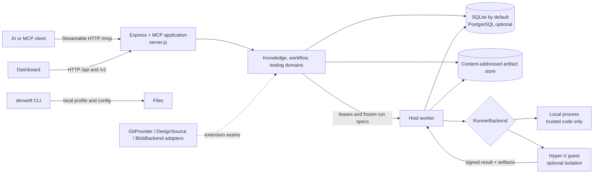

# Architecture

DevWeft is a self-hosted control plane for engineering knowledge, workflow tools, and evidence-backed test runs. The HTTP API and MCP server share the same application process. Test execution is optional and runs in a separate worker process.

## Component map

The diagram describes logical responsibilities, not a required deployment topology. A basic installation can run the application and SQLite on one machine without a worker. PostgreSQL, a separate blob process, standby control plane, and Hyper-V are optional deployment modes.

## Request and test-run lifecycle

1. An MCP client, dashboard, or CLI calls the application. Repository selection and tenant context are resolved before domain work.
2. The testing domain validates a submission against the repository profile, test suite, policy, and current run settings. It stores a frozen run specification and provenance digests.
3. A worker claims a lease. It runs the selected lane through a `RunnerBackend`, then reports a signed result and uploads content-addressed artifacts.
4. The application persists status, checks, step timeline, and artifact references. The dashboard derives diagnostics, comparisons, feedback, and trends from stored evidence.
5. The evidence package exports an explicit allowlist of metadata and hashes. It does not package source trees, raw report bodies, or raw log archives.

Skipped, incomplete, or missing check results remain distinct states. They are not counted as passing in gates, comparisons, or trend denominators.

## Source map

| Area | Main source locations | Responsibility |
|---|---|---|
| Application startup and HTTP/MCP registration | `server.js`, `dashboard/`, `tools/` | HTTP routes, dashboard serving, MCP tools, health endpoints |
| Database and schema lifecycle | `db.js`, `db/`, `testing/migrate.js`, `testing/schema-v*.sql`, `sql/postgres/` | SQLite/PostgreSQL access, versioned migration ledger, generated PostgreSQL baseline |
| Testing domain | `testing/` | Submission, suites, leases, policies, result evidence, diagnostics, comparisons, feedback, trends |
| Worker and execution backends | `runner/host-worker/`, `runner/local/`, `runner/guest-agent/` | Claim runs, prepare snapshots, execute lanes, sign and return results |
| Repository/project configuration | `data/repo-platform.example.json`, `schemas/`, `templates/`, `bin/` | Repository profiles, project checks, CLI onboarding and validation |
| Adapters | `extensions/`, `testing/remotes.js`, `testing/lanhu-gateway.js`, `testing/blob-store-env.js` | Validated seams for Git, design source, runner and artifact storage |
| Deployment | `deploy.cmd`, `start*.cmd`, `scripts/`, `ecosystem.config.cjs` | Windows entry points, environment preflight, PM2 and optional host setup |
| Public fixtures and tests | `examples/`, `suites/`, `test/` | Offline sample project, test assets, unit and integration checks |

## Persistence and migrations

SQLite is the default for local use. PostgreSQL is supported for deployments that need a shared database or primary/standby control plane. The blob directory is independent of the database and must be backed up separately.

`npm run db:init` invokes the migration runner and readiness checks. SQLite migrations are tracked by version, name, and SHA-256 checksum. PostgreSQL starts from `sql/postgres/baseline.sql`, then applies the PostgreSQL patch-up manifest. Startup fails closed when an applied migration is unknown or its name/checksum differs from the current manifest.

See [Configuration reference](CONFIGURATION.md) for settings and [Setup and operations](../ONBOARDING.md) for PostgreSQL initialization, backup, restore, and deployment procedures.

## Extension boundaries

Use the small interfaces in `extensions/contracts.js` when adding a provider or backend. The core should not require an optional provider SDK or contact a vendor by default. Keep adapter-specific code outside the domain, map failures to stable extension error codes, and add contract tests for success, invalid input, unsupported behavior, and transient unavailability.

The local runner executes repository code with the host user's permissions and is not an isolation boundary. Hyper-V is an optional execution mode and requires a separately prepared image and a compatible Windows host. Descriptive adapter capabilities never bypass existing permissions, secrets, or lane checks.

## Deployment shapes

| Shape | Processes and storage | Intended use |
|---|---|---|
| Local | App + SQLite + local blob directory | Development and single-machine evaluation |
| Single host with PostgreSQL | App + PostgreSQL + blob service | Shared-database deployments on one host |
| Primary/standby | Two control planes + shared external PostgreSQL + primary blob endpoint | Manual control-plane failover; artifact replication is not automatic |
| Isolated worker | Host worker + Hyper-V guests + signed image | Running untrusted test code in the supported Windows isolation mode |

For readiness fields and failure recovery, see [Availability and artifact storage](AVAILABILITY.md). Real Windows, Hyper-V, PostgreSQL-server, and failover checks remain separate from the cross-platform unit test suite; see [real-host acceptance](validation/REAL-HOST-ACCEPTANCE.md).
